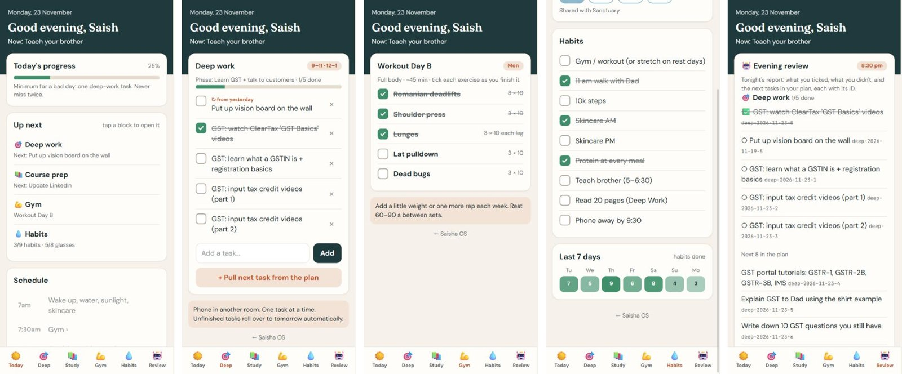

# Saisha OS

A personal life operating system: one place for uni, career, wellbeing, creativity, money and daily routines, with an AI companion built in. It now includes a mobile-first **Daily Planner** that runs as a home-screen app on Android, with an AI evening review that can't make up tasks.



## What's inside

| Area | What it does |
| --- | --- |
| **Zenith** (dashboard) | Courses and assignments, career milestones, daily rituals, focus |
| **Sanctuary** | Self-care log: hair and skin routines, mood, water, journal |
| **Studio** | Songwriting drafts (lyrics, key, tempo, chords) |
| **Ledger** | Budget, savings goal, spending categories |
| **AI chat** | Gemini companion that can add tasks to Saisha OS |
| **Daily Planner** (`/planner`) | Today view, deep work and course prep to-do lists that roll over, habits and water, gym A/B plan, AI evening review, CSV export |

Data syncs to Supabase when you're signed in, and falls back to `localStorage` when Supabase isn't configured.

## Tech stack

- **Frontend:** React 19, TypeScript, Vite 6, Tailwind CSS 4 (dashboard), plain CSS + Framer Motion + canvas-confetti (planner), installable PWA
- **Backend:** one Cloudflare Worker ([`worker.ts`](worker.ts)) that serves the static build and the `/api/*` routes
- **Database and auth:** Supabase (Postgres with Row Level Security on every table; Google and email sign-in)
- **AI:** Google Gemini via `@google/genai`, called only from the Worker
- **Tests:** Vitest (104 tests)

## Project structure

```
worker.ts                      Production entry: API routes + static assets (SPA fallback)
worker/planner/                Planner API (AI review), Gemini retry/fallback, Supabase access
src/App.tsx                    Saisha OS dashboard
src/planner/                   Daily Planner
  plan.ts                      Plan data: phases, DEEP/STUDY queues, habits, schedule, workouts
  logic.ts                     Pure logic: rollover, fill to 5, gym rotation, CSV, backup import
  gym.ts                       Gym sessions by weekday, yoga timer, weights, India time
  workouts.ts                  Exercise catalogue, swaps, your own Day A / B (just today or always)
  water.ts                     Water in ml: bottle, anchors, other drinks, gradual weekly goal
  sound.ts                     Sounds (Web Audio) and vibration, with settings
  ui.tsx                       Enchanted Kingdom look: stars, Lumi, orb ticks, bouncy buttons
  validate.ts                  Anti-hallucination validation for AI plans
  report.ts                    Evening review report
  store.ts, usePlanner.ts      Supabase / localStorage persistence and state
  PlannerApp.tsx, screens.tsx  UI and /planner/* routes
supabase_schema.sql            Full database schema
supabase/migrations/           Incremental migrations (run just the new part)
docs/planner-prototype.html    Original single-file prototype (reference only)
```

## Run it locally

You need Node 20+ and a Supabase project. A Gemini API key is only needed for the AI features.

1. **Install:**
   ```bash
   npm install
   ```
2. **Database:** in Supabase → SQL Editor, run [`supabase_schema.sql`](supabase_schema.sql) for a new project. For an existing project, run only the new migrations in [`supabase/migrations/`](supabase/migrations/).
3. **Frontend settings:** copy `.env.example` to `.env` and fill in `VITE_SUPABASE_URL` and `VITE_SUPABASE_ANON_KEY` (use the publishable key, never the secret key).
4. **Worker secrets:** copy `.dev.vars.example` to `.dev.vars` and fill in `GEMINI_API_KEY`, `SUPABASE_URL` and `SUPABASE_ANON_KEY`.
5. **Supabase sign-in redirects:** in Supabase → Authentication → URL Configuration, add `http://localhost:5173/**` to **Redirect URLs**.
6. **Start:**
   ```bash
   npm run dev
   ```
   Open http://localhost:5173 (dashboard) or http://localhost:5173/planner (planner). `npm run dev` runs the real `worker.ts` through `@cloudflare/vite-plugin`, so the API behaves exactly as it does in production.

Other scripts: `npm test` (Vitest), `npm run lint` (type-check), `npm run build`, `npm run preview` (production build served by the local Workers runtime).

**Dev-only date override:** `/planner?date=2026-11-23` pretends today is that date, which is handy for testing gym days and rollover. It's removed from production builds. **Careful:** opening a date creates that day's list in your real Supabase data (the same as opening the planner on that day), so delete test days afterwards or use a test account.

## Deploy (Cloudflare Workers)

The app is a single Worker with static assets ([`wrangler.json`](wrangler.json)). `assets.not_found_handling: "single-page-application"` makes deep links like `/planner/deep` load the app directly.

### 1. Worker secrets (runtime)

Set these once. They survive redeploys.

```bash
npx wrangler secret put GEMINI_API_KEY
npx wrangler secret put SUPABASE_URL
npx wrangler secret put SUPABASE_ANON_KEY
```

Optional: `GEMINI_MODEL` (default `gemini-3.6-flash`) and `GEMINI_FALLBACK_MODEL` (default `gemini-flash-lite-latest`, or `none`). You can also set all of these in the Cloudflare dashboard under **Workers & Pages → saishaos → Settings → Variables and Secrets**. `keep_vars: true` in `wrangler.json` stops a deploy from wiping them.

### 2. Frontend values (build time)

`VITE_SUPABASE_URL` and `VITE_SUPABASE_ANON_KEY` are baked into the browser bundle when it's built:

- **Deploying from your machine** (`npm run deploy`): they're read from `.env`.
- **Cloudflare Git builds:** add them under **Settings → Build → Variables and secrets**. Use build command `npm run build` and deploy command `npx wrangler deploy`.

### 3. Supabase

In **Authentication → URL Configuration**:
- set **Site URL** to your Worker URL
- add `https://<your-worker-url>/**` to **Redirect URLs**

### 4. Check it

`/api/health` should return `{"status":"ok"}`, and `/planner/deep` should open the planner.

## Daily Planner

### Routes (for MacroDroid)

| URL | Opens |
| --- | --- |
| `/planner` | Today: greeting, current schedule block, progress, up next |
| `/planner/deep` | Deep work list (9–11 and 12–1) |
| `/planner/study` | Course prep and career list (2:00–3:30) |
| `/planner/gym` | Today's session: strength (Mon/Wed/Fri), cardio + core (Tue/Thu), yoga (Sat), rest (Sun) |
| `/planner/habits` | Habits, water and the last 7 days |
| `/planner/review` | Evening review, CSV export, prototype backup import |
| `/planner/settings` | My workouts (undo swaps), sound and vibration |

Install it from Chrome (**⋮ → Add to Home screen**). It opens standalone at `/planner`, with shortcuts to Deep, Study, Habits and Review.

### How the lists work

- **First time a day is opened:** unfinished tasks from the most recent previous day are carried over (marked "↻ from yesterday"). The list is then filled from the plan queue, in order, up to 5 tasks. Only tasks whose phase has started and that aren't done are used.
- **Your own actions:** tick a task done, remove it from today (plan tasks go back into the queue; your own tasks are deleted), add your own task, or **pull the next task** (from a future phase if the current one is empty).
- **Habits:** water and skincare AM/PM share Sanctuary's `health_logs` rows, so both screens always show the same value. The other habits and gym ticks use `habit_logs`.
- **Water (no reminders):** tracked in ml (`health_logs` metric `water_ml`). One tap for "Finished a bottle" (bottle size in Settings), "+250 ml glass", or other drinks (chaas, coconut water, nimbu pani, herbal tea, soup). **Water anchors** on Today tie a glass to things you already do (after waking, before meals, refill at each deep-work block, after the walk with Dad); each ticked anchor adds 250 ml unless its "from my bottle" toggle is on. The goal starts at 1.25 L and rises 0.25 L after every week with 5 days at the goal, up to 2 L. The Moonlit Garden fountain fills up; reaching the goal plays a sparkle. Missed days are never mentioned.
- **Gym:** Mon/Wed/Fri strength (odd ISO weeks A, B, A; even ISO weeks B, A, B), Tue/Thu cardio + core, Sat yoga, Sun rest. Each strength exercise has an optional kg box and shows "Last: …" from the previous session. Each yoga pose has a Start button and a countdown that cues "switch sides" at half time. Ticking every item of the day's session ticks the gym habit. Sunday needs no gym tick (it isn't counted in progress, the CSV or the report).
- **Swapping exercises:** every strength exercise has **⇄ Swap** (alternatives for the same muscle group, or "Other…"), then **Just today** or **Always swap**. **Edit workout** reorders, adds or removes exercises for that day or always. Logs store the exercise you actually did (`exercise_key`) and the one it replaced (`planned_key`), so "Last: X kg" and NEW BEST follow what you did. Undo permanent changes in Settings → My workouts.
- **Time zone:** "today" is always India time (Asia/Kolkata), whatever the device is set to.
- **Live sync:** the planner listens to Supabase Realtime, so a tick on the phone shows on the laptop within about a second. It also refetches when the app comes back to the foreground.
- **Sounds:** the Nth tick of the day plays `tick-N` (6+ = `tick-6`), then `xp-sparkle`. A finished block plays `block-complete`, approving the evening review plays `good-night`, and the first tap before noon plays `wake-up` once a day. Nothing plays before the first tap. Sound on/off, volume (default 70%) and vibration are on the Review screen, saved per device.
- **CSV** (`date, category, item, done`): a task counts as done (`1`) only on the day it was finished.
- **Prototype backup import:** paste the old planner's "Copy backup" JSON on the Review screen. Days that already exist are kept, so it's safe to run twice.

### Database tables

| Table | Holds |
| --- | --- |
| `plan_tasks` | The plan queue (IDs such as `deep-2026-11-23-4`, unique per user) plus custom and AI ✨ tasks |
| `planner_days` | Days that have been opened (so an emptied list isn't refilled), plus notes |
| `daily_list_items` | Each day's deep/study list; the database refuses a task listed under the wrong block |
| `task_completions` | Which tasks are done, and on which date |
| `habit_logs` | Habits without an existing home (including the after-meal walks); old prototype gym ticks |
| `user_settings` | Small preferences per user: bottle size, when the water goal started, "from my bottle" anchors |
| `exercise_logs` | Gym exercises, cardio items and yoga poses per day: done, sets, reps, optional weight, and the planned exercise it replaced |
| `workout_plans` | Your own Day A / Day B: `scope` is `always` or one date; `items` is the ordered exercise list |

Every table has RLS: `auth.uid() = user_id` for both reads and writes. The app adds the plan tasks for a user the first time they open `/planner`.

## AI evening review: anti-hallucination design

At 8:30 pm, `/planner/review` shows today's report and a **Plan tomorrow** button. Gemini proposes tomorrow's lists, but **nothing it says is trusted or saved without passing these layers:**

1. **Signed-in users only.** The Worker verifies the Supabase session (JWT) before calling Gemini or the database. Every query runs as that user, so RLS applies; there's no service key.
2. **Server-side facts.** The Worker builds the report from the database itself. It never trusts plan data sent by the phone.
3. **Constrained output.** Gemini must reply in JSON matching a response schema: `{"deep":[ids], "study":[ids], "new":[{block,text,reason}], "note":"…"}`. The ID lists are an `enum` of exactly the IDs in the report, so the model can't produce an unknown ID.
4. **Validation anyway** ([`src/planner/validate.ts`](src/planner/validate.ts)). Every ID must exist in the user's plan, be in the right block and not be done. Duplicates are dropped, there are at most 6 tasks per block, and future-phase tasks are accepted only after every current-phase task is used. Task text always comes from the database, never from the model. Anything dropped is reported with a reason.
5. **New tasks only by name.** Work that isn't in the plan can only arrive through the `new` array. It's cleaned, length-checked, rejected if it duplicates an existing task, and saved as a custom task flagged ✨.
6. **Human approval.** You see a preview (accepted tasks, rejected items with reasons, new ✨ tasks). Only **Approve** saves, and the Worker **validates again** on approve, so a tampered request can't slip in an ID.
7. **Resilient calls.** Busy, rate-limited or timed-out calls are retried with backoff within a time limit. If the primary model is still busy, a lighter model is tried once. Errors are shown in plain language.

Tests prove it: `src/planner/validate.test.ts` and `worker/planner/api.test.ts` cover made-up IDs being rejected and never saved, tampered approvals, missing or forged tokens, and non-JSON replies.

## Known issues / tech debt

- **`journal_entries` row IDs aren't per user.** Sanctuary builds them from the date only (`toUUID("journal-" + date)`), so two accounts could collide. (`health_logs` had the same problem; it's fixed: rows are matched on `(user_id, metric, logged_at)`.)
- **Old `water_cups` rows are kept** after converting them to `water_ml`; nothing reads them any more. They can be deleted later.
- **AI chat bugs (`/api/saisha/interact`).** The live handler reads `role`/`content`, but the app sends `sender`/`text`, and its task inserts use columns that don't exist. To be fixed on `fix/ai-chat`.
- **Legacy files.** [`server.ts`](server.ts) (old AI Studio Express server, `npm run dev:express-legacy`) and the Pages Functions layout in `functions/` are legacy. `functions/api/saisha/interact.ts` is still imported by `worker.ts` until it moves into `worker/`. `assets/.aistudio` and `metadata.json` are AI Studio leftovers.
- **Approving tomorrow's list isn't atomic.** It's several Supabase calls; a failure halfway could leave a partial list. Approving again fixes it. A Postgres function would make it atomic.
- **No offline mode.** There's no service worker yet, so the planner needs a connection.
- **Realtime DELETE events aren't filtered by user.** Supabase can't filter deletes by column, so every signed-in client gets a "something was deleted" ping (with only the row's primary key) and refetches its own data through RLS. Fine for a personal app; revisit if more people use it.
- **Reps aren't entered yet.** `exercise_logs.reps` stays empty until Phase 2 adds a reps input for double progression.
- **No `@types/react`.** JSX is loosely typed, so type-checking catches less in components.
- **Gemini free tier.** Heavy testing can exhaust the daily quota (429). The fallback model is only used for busy or timed-out errors.

## License

Apache-2.0 (see file headers).
